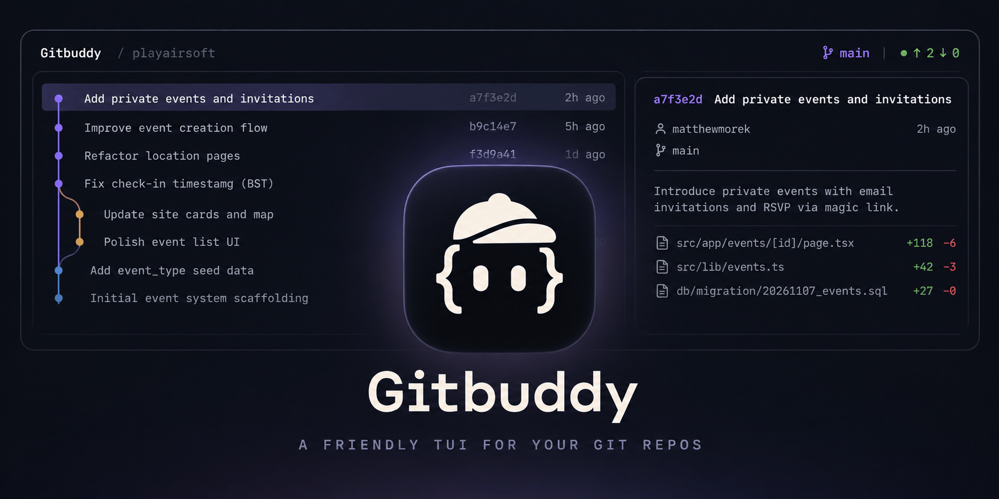

# Gitbuddy

A keyboard-first Git history and working-copy browser for your terminal.

Browse commits, inspect local changes and unified diffs, and fetch or pull
without leaving the terminal. **Ctrl+P** puts commands and settings in one place.

- History and commit details side by side, with a single-pane layout on smaller terminals.
- Current-branch or all-branch history, periodic fetching, and explicit pull modes.
- Read-only staged/unstaged comparisons and bounded untracked-file previews.
- OpenCode, Tokyo Night and Catppuccin palettes in light, dark or system mode.

[Install](#install) · [Use](#use) · [Update](#update) · [Uninstall](#uninstall) ·
[Contribute](#contribute) · [Releases](https://github.com/matthewmorek/gitbuddy/releases)

## Why Gitbuddy?

Gitbuddy fills the space between `git log` and a full Git GUI: a focused way to
understand a repository's history and keep it current, using the keyboard.
It takes inspiration from Tower's focused Git workflows and OpenCode's spacious
terminal interface.

It is deliberately not an all-in-one Git client. Keep using your preferred tools
for staging, committing, pushing and resolving conflicts. Git remains the source
of truth; Gitbuddy adds a view over it.

## Install

For macOS on Apple Silicon and Linux x86_64. Requires a terminal and Git.

Install the latest stable release with the command below. It runs a downloaded
script; you can [inspect it first](docs/USAGE.md#installation-options-and-security).

```sh
curl -fsSL https://matthewmorek.github.io/gitbuddy/install.sh | sh
```

Installs to `~/.local/bin` without `sudo`, shell-profile edits or preference
changes. If `gitbuddy` is not found, add that directory to your current shell:

```sh
export PATH="$HOME/.local/bin:$PATH"
```

macOS binaries are unsigned and not notarized. If Gatekeeper blocks execution,
do not disable it or remove quarantine; [report the issue](https://github.com/matthewmorek/gitbuddy/issues).
See the [user guide](docs/USAGE.md#installation-options-and-security) for installer
options and platform requirements.

## Use

Run from a Git repository, or give Gitbuddy its path:

```sh
gitbuddy
gitbuddy /path/to/your/repository
```

Repository subdirectories also work. History opens on the **current branch and
its upstream**, including incoming commits; choose **Ctrl+P → All branches** for
the wider view. Start with **Ctrl+P** to explore commands and settings.
Press **2** or click **Working copy** to inspect changed files; **1** returns to
**History**. Choose history scope in the palette, which marks the active value.
Working-copy browsing never stages or edits files.

| Key                 | Action                                                    |
| ------------------- | --------------------------------------------------------- |
| Ctrl+P              | Search commands **and individual settings**               |
| 1 / 2               | Select History / Working copy                             |
| ↑ / ↓ or k / j      | Select a commit/file; scroll focused details               |
| ← / →               | Scroll working-copy details horizontally                  |
| Page Up / Page Down | Move a page                                               |
| Tab / Shift+Tab     | Switch pane                                               |
| Enter               | Open details on a narrow terminal; apply a palette choice |
| Escape              | Close a dialog or return to the active mode's list        |
| r                   | Refresh local history, status and selected file           |
| q                   | Quit outside text input                                   |
| Ctrl+C              | Close a dialog; otherwise request orderly quit            |

Automatic fetching starts after local history renders and repeats **every five
minutes** by default. Disable it or change the interval in **Ctrl+P → Settings**.
Pulling always requires choosing an explicit command.
Local changes refresh on entering Working copy, on **r**, and after fetch/pull.
There is no filesystem watcher; refresh after external edits. Mixed staged and
unstaged changes share a file row but have separate labeled comparisons.
Each file occupies one row with staged/unstaged status positions and right-aligned
line counts or a binary indicator. The list header shows refresh activity once,
then **Ready · just now** with a relative age.
Space has no staging action; commit details still show statistics, not patches.

See the [user guide](docs/USAGE.md) for history limits, pull safety, preferences,
custom themes and update behavior.

## Update

Gitbuddy checks for a newer **stable** release in the background after startup.
It never installs an update or restarts without your choice.

1. Open **Ctrl+P → Check for updates** to check manually.
2. Choose **Install update** and press Enter to install an available newer version.
3. Choose **Restart** when ready, or use the new version on your next launch.

Settings are preserved. See the [user guide](docs/USAGE.md#updates-and-shutdown)
for advanced update options and restrictions.

## Uninstall

Quit Gitbuddy, then remove the executable from the default installation:

```sh
rm -- "$HOME/.local/bin/gitbuddy"
```

If you used `--install-dir`, remove only the `gitbuddy` executable there instead.
Your repositories are unaffected. Preferences and custom themes are kept in
`${XDG_CONFIG_HOME:-$HOME/.config}/gitbuddy`; optionally back them up and remove
that folder manually if you want to forget your settings too.

## Contribute

[Report a bug or suggest an improvement](https://github.com/matthewmorek/gitbuddy/issues).
For a bug, include your Gitbuddy version, OS/architecture and a minimal
reproduction without private repository data. Discuss larger changes in an issue
before implementing them.

For code changes, fork the repository and clone your fork. From the checkout,
with **Go 1.26.7 or newer**, Git and Python 3:

```sh
go run ./cmd/gitbuddy /path/to/your/repository
go test ./...
go test -race ./...
go vet ./...
python3 -m unittest discover -s scripts
python3 scripts/smoke-terminal.py
```

Go may download the toolchain required by `go.mod`. Python is currently used for
build/release tooling and its tests, not the application's Go unit tests.
[Moving that tooling to Go is tracked separately](https://github.com/matthewmorek/gitbuddy/issues/1).
Development builds cannot replace themselves through the updater.

Keep changes focused, add regression coverage for behavior changes, and open a
pull request explaining what changed, why, and which checks you ran. For
documentation-only changes, check links, examples and formatting; no version bump
or release is needed.

See [release preparation](docs/RELEASING.md) for standalone builds, packaging and
the manual publication process. Public install, Gatekeeper, accessibility and
real installed-update tests are separate from automated test coverage.

## License and acknowledgments

Gitbuddy is [MIT-licensed](LICENSE), built with Go, Bubble Tea, Lip Gloss and
Bubbles. Bundled components retain their own licenses.
See [third-party notices](THIRD_PARTY_NOTICES.md), the
[licensing guide](docs/LICENSING.md), or run `gitbuddy --licenses`.
